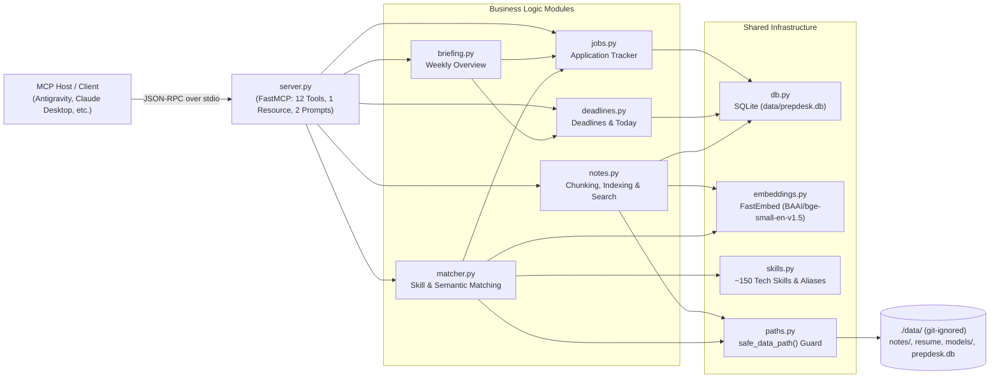

# PrepDesk

A local Model Context Protocol (MCP) server that acts as a study and placement assistant for students—tracking job applications, managing deadlines, indexing/searching lecture notes, matching resumes to job descriptions, and generating weekly briefings.

## Architecture



## Quick Start

### 1. Install dependencies

Requires Python 3.11+ and [`uv`](https://docs.astral.sh/uv/).

```bash
uv sync
```

### 2. Try with sample data

Your personal `data/` directory is git-ignored. To try PrepDesk immediately with the included fake notes and resume:

```bash
mkdir -p data/notes
cp -r sample_data/notes/* data/notes/
cp sample_data/resume.txt data/resume.txt
```

*(When using `match_resume` with the sample `.txt` resume, pass `resume_path="data/resume.txt"`, or place your own PDF at `data/resume.pdf`.)*

### 3. Configure your MCP client

Add PrepDesk to your MCP client config (for example `~/.gemini/config/mcp_config.json`), replacing the paths with your local `uv` binary and project directory:

```json
{
  "mcpServers": {
    "prepdesk": {
      "command": "/path/to/uv",
      "args": ["--directory", "/path/to/PrepDesk", "run", "server.py"]
    }
  }
}
```

### 4. Run tests

```bash
uv run pytest -v
```

## MCP Surface

- **Tools:** `ping`, `add_application`, `update_application`, `list_applications`, `followups_due`, `get_today`, `add_deadline`, `list_deadlines`, `index_notes`, `search_notes`, `match_resume`, `weekly_briefing`
- **Resource:** `deadlines://upcoming`
- **Prompts:** `quiz_me(topic, num_questions)`, `weekly_plan()`
