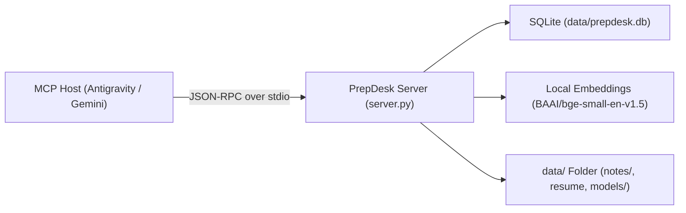

# PrepDesk

[](https://github.com/SarvyagyaPrakash/PrepDesk/actions/workflows/tests.yml)

A local MCP server for students to track job applications, manage deadlines, search lecture notes, and match resumes to job descriptions.

## What It Is and Why MCP

PrepDesk is a local assistant that keeps your job applications, study deadlines, lecture notes, and resume on your own machine instead of uploading them to a third-party service. It uses the Model Context Protocol (MCP), which gives AI apps a standard way to call local Python tools and read local resources without custom glue code. Instead of pasting your resume or entire lecture PDFs into every chat, the host asks PrepDesk for just the relevant facts. PrepDesk was built with AI-assisted development in Antigravity and tested with Antigravity (Gemini) as the MCP host.

## Architecture



PrepDesk follows a simple split: the MCP server fetches structured facts, matching scores, and note passages from your local files and SQLite database, and the LLM uses those facts to write clear, grounded answers.

## Features

| Type | Name | Description | Example Request |
| :--- | :--- | :--- | :--- |
| Tool | `ping` | Checks that the PrepDesk server is running. | "Use the prepdesk ping tool." |
| Tool | `add_application` | Logs a new job application with status, link, and notes. | "Add an application for Acme, Backend Intern, status applied." |
| Tool | `update_application` | Updates an application's status or notes by ID. | "Update application 1 to oa with notes 'Completed HackerRank'." |
| Tool | `list_applications` | Lists applications, optionally filtered by status. | "Show all my applications in the interview stage." |
| Tool | `followups_due` | Lists active applications (`applied`, `oa`, `interview`) untouched for N days. | "Which applications haven't been updated in 7 days?" |
| Tool | `get_today` | Returns today's local `YYYY-MM-DD` date and weekday name. | "What is today's date?" |
| Tool | `add_deadline` | Saves a deadline with a `YYYY-MM-DD` due date and optional course. | "Add a deadline: OS exam this Friday." |
| Tool | `list_deadlines` | Lists overdue and upcoming deadlines within `days_ahead` days. | "What deadlines are due in the next 10 days?" |
| Tool | `index_notes` | Indexes `.pdf`, `.md`, and `.txt` files inside `data/`. | "Index my notes." |
| Tool | `search_notes` | Searches indexed note chunks by cosine similarity. | "Search my notes: how does TCP Fast Retransmit work?" |
| Tool | `match_resume` | Compares a resume against a job description and optionally logs to an application. | "Match my resume to this Backend Developer Intern JD." |
| Tool | `weekly_briefing` | Summarizes today's date, overdue/upcoming deadlines, and follow-ups due. | "What should I focus on this week?" |
| Resource | `deadlines://upcoming` | Read-only plain-text snapshot of overdue and next-14-days deadlines. | Read `deadlines://upcoming` in an MCP client. |
| Prompt | `quiz_me` | Guides the LLM to run a 1-question-at-a-time quiz grounded in your notes. | Run prompt `quiz_me` with `topic="DBMS Normalization"`. |
| Prompt | `weekly_plan` | Guides the LLM to build a 7-day plan from `weekly_briefing` (max 3 items/day). | Run prompt `weekly_plan`. |

## How It Works

### (a) Notes Search
`notes.py` reads `.pdf` (page by page with `pypdf`), `.md`, and `.txt` files inside `data/notes/` and splits text into chunks of up to 800 characters with 150-character overlap on paragraph, sentence, or word boundaries. `embeddings.py` lazily loads `BAAI/bge-small-en-v1.5` via `fastembed` (cached in `data/models/`), computes L2-normalized `float32` vectors, and stores them in SQLite (`chunks`). Unchanged files are skipped using SHA-256 hashes in `indexed_files`. `search_notes` embeds your question and ranks all stored chunks using NumPy dot-product cosine similarity, returning the top matches with source file, page number, and score.

### (b) Resume Matcher
`matcher.py` reads `data/resume.pdf` by default, falling back to `data/resume.txt` if no PDF exists (or uses an explicit `resume_path` inside `data/`). It runs two checks:
1. **Skills check:** `skills.py` scans both the resume and job description against 157 canonical tech skills and aliases (handling `C++`, `C#`, `node.js`, `ci/cd`, and `kubernetes`/`k8s` while avoiding ambiguous names like `R` and `Go`).
2. **Semantic requirement check:** Requirement lines from the JD (bullet lines plus sentences with cue words, capped at 40) are embedded and compared against resume units (20–300 chars) by cosine similarity. A requirement counts as matched when similarity is at least `MATCH_THRESHOLD = 0.60`.

The overall score is `0.6 * skills_coverage + 0.4 * requirement_coverage` (falling back to whichever side is non-empty). Parsed and embedded resumes are cached in memory by file SHA-256.

### (c) Job Tracker and Deadlines
`db.py` initializes `data/prepdesk.db` (overridable via `PREPDESK_DB` for tests) with `applications` and `deadlines` tables. `jobs.py` validates application statuses against `wishlist`, `applied`, `oa`, `interview`, `offer`, and `rejected`, tracks UTC ISO-8601 timestamps, and flags stale active applications in `followups_due`. `deadlines.py` validates real `YYYY-MM-DD` calendar dates and computes `days_left` and `status` (`overdue`, `today`, or `upcoming`) relative to local `date.today()`.

## Quickstart

### Prerequisites
- Python 3.11+
- [`uv`](https://docs.astral.sh/uv/)

### 1. Clone and install
```bash
git clone https://github.com/SarvyagyaPrakash/PrepDesk.git
cd PrepDesk
uv sync
```

### 2. Load the sample data
`data/` is git-ignored so your personal files stay private. Copy the demo files into `data/` to try PrepDesk right away:
```bash
mkdir -p data/notes
cp sample_data/notes/*.md data/notes/
cp sample_data/resume.txt data/resume.txt
```

### 3. Configure Antigravity
Add `"prepdesk"` to your `~/.gemini/config/mcp_config.json` using absolute paths (find them with `which uv` and `pwd`):
```json
{
  "mcpServers": {
    "prepdesk": {
      "command": "/ABSOLUTE/PATH/TO/uv",
      "args": [
        "--directory",
        "/ABSOLUTE/PATH/TO/PrepDesk",
        "run",
        "server.py"
      ]
    }
  }
}
```
Restart or refresh Antigravity to load the server.

### 4. Inspect with MCP Inspector
You can test tools, resources, and prompts directly without an LLM host:
```bash
npx @modelcontextprotocol/inspector uv --directory /ABSOLUTE/PATH/TO/PrepDesk run server.py
```

## Example Conversations

1. **Index and query sample notes:**
   > **User:** Index my notes, then explain 3NF with an example from my notes.  
   > **Assistant:** Calls `index_notes()` and `search_notes("3NF example")`, then explains Third Normal Form and the `Courses` / `Instructors` decomposition citing `notes/dbms_normalization.md`.

2. **Check CPU scheduling:**
   > **User:** Search my notes for Round Robin scheduling with quantum 4.  
   > **Assistant:** Calls `search_notes("Round Robin scheduling quantum 4")` and walks through the `P1, P2, P3` Gantt chart and average waiting time from `notes/os_scheduling.md`.

3. **Match the sample resume to the sample JD:**
   > **User:** Match my resume to the Backend Developer Intern job description in `sample_data/job_description.txt`.  
   > **Assistant:** Calls `match_resume(job_description=...)` (automatically picking up `data/resume.txt`), reports matched skills (`python`, `sql`, `rest api`, `git`) and missing skills (`docker`, `kubernetes`, `aws`), and suggests next steps to close the gaps.

4. **Plan the week:**
   > **User:** Add a deadline for my Networks quiz this Friday, then tell me what to focus on this week.  
   > **Assistant:** Calls `get_today()`, computes Friday's `YYYY-MM-DD` date, calls `add_deadline(...)`, and runs `weekly_briefing()` to summarize upcoming items.

## Design Decisions and Safety

- **Path sandbox:** `paths.py` (`safe_data_path`) resolves all note and resume paths and rejects anything outside `data/` (including `..` traversals and absolute paths like `/etc`).
- **Parameterized SQL:** All SQLite queries in `jobs.py`, `deadlines.py`, and `notes.py` use `?` placeholders; no SQL is built with f-strings or concatenation.
- **PII redaction:** Before returning `resume_evidence` to the LLM, `matcher.py` redacts email addresses and phone numbers.
- **Write-tool approval:** State-changing tools (`add_application`, `update_application`, `add_deadline`, `index_notes`, and `match_resume` with `application_id`) are cleanly separated from read-only tools so the MCP host can require user approval before writes.
- **Offline after first model download:** Once `BAAI/bge-small-en-v1.5` is cached in `data/models/`, indexing, search, and resume matching make zero network calls.
- **Stdio safety:** `server.py` and all modules never call `print()` to `stdout`; all logs go to `stderr` via Python's `logging` module.

## Testing

Run the full test suite (uses temporary databases via `PREPDESK_DB` and temporary `data/` folders via `PREPDESK_DATA_DIR`):
```bash
uv run pytest -v
```

Run only fast unit tests (skipping tests that load the real embedding model):
```bash
uv run pytest -m "not slow" -v
```

Run only the real-model integration tests:
```bash
uv run pytest -m slow -v
```

## Limitations

- `match_resume` produces a rough heuristic score combining keyword and embedding similarity; it is not an Applicant Tracking System (ATS).
- Scanned or image-only PDFs have no extractable text and are skipped during `index_notes` (or rejected in `read_resume`).
- `BAAI/bge-small-en-v1.5` is an English-only embedding model.
- Storage uses a single-user local SQLite file (`data/prepdesk.db`).
- `quiz_me` and `weekly_plan` use MCP Prompts, which only appear in hosts that support MCP prompts.
- Primarily tested with Antigravity as the MCP host.

## Possible Next Steps

- Add optional OCR fallback (such as `pytesseract`) for scanned lecture PDFs.
- Add `complete_deadline` / `delete_deadline` tools to mark finished assignments done.
- Add a GitHub Actions workflow to run `uv run pytest -m "not slow"` on every push.
- Support filtering `search_notes` by course or subfolder inside `data/notes/`.
